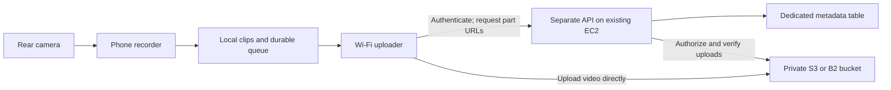

# RB1 Speed dashcam design and implementation

Status: implemented for local validation in version 1.6.0, November 15, 2026. The initial owner-run AWS deployment has since completed and passed read-only template, shared-host, policy, SSM and site checks. Physical-device camera/S3 upload testing remains pending. This document distinguishes implemented behavior from remaining acceptance gates. See `infra/README.md` for the guarded deployment runbook.

## Recommendation

Record locally using the rear road-facing camera while externally powered. Produce playable 15-minute MP4 clips, retain them in a bounded local loop, and upload verified copies directly to private object storage when suitable Wi-Fi becomes available. Recording must continue without the API, internet, or storage provider.

Use the existing Piggy Ledger EC2 host only for a small, separate authenticated upload API. Do not send video through it. Start with S3 Standard in us-east-1 for integration with the existing AWS instance role; Backblaze B2 is the lower-cost alternative. Keep provider details behind the backend rather than embedding AWS operations or credentials in the phone.

Implemented defaults (recording is opt-in):

| Setting | Proposed value |
| --- | --- |
| Camera | Rear primary camera, landscape, hardware H.264 encoder |
| Video | 1080p, 30 fps, target 8 Mbit/s, MP4 |
| Microphone | Off; audio recording would be a separate opt-in |
| Clip duration | 15 minutes; shorter final clip at end of trip |
| Recording start | App visible, dashcam enabled, camera permission granted, external power connected |
| Recording stop | Manual stop, permission/camera error, thermal protection, or 10 seconds continuously on battery |
| Local quota | 32 GiB initially; selectable 8/16/32/64 GiB |
| Free-space reserve | At least 5 GiB; includes space for assembling a clip |
| Full-storage policy | Loop mode: delete uploaded ordinary clips first, then oldest unprotected pending clips if necessary; show lost-before-upload count |
| Protected incidents | Never automatically overwrite; warn and stop if only protected footage remains |
| Upload network | Validated, unmetered Wi-Fi only; never silently fall back to cellular |
| Upload battery | Allowed after ignition-off, above 30%, with an initial 30-minute battery-session budget |
| Cloud retention | Routine footage: 30 days after successful upload; protected incidents: until explicitly deleted |

The battery threshold, budget, bit rate, and quota are design choices to tune on the actual phone, not measured device capabilities.

## Architecture

## Recording and recovery

The implementation uses a foreground camera service with a persistent recording notification and stop action. The dashboard observes the service; it does not own the camera. Rotation, opening Debug, or briefly switching apps should not restart recording. Camera permission is requested from the visible app. A force-stop, reboot, permission revocation, or camera contention must produce a visible stopped/error state on return rather than an implied recording state.

Android restricts starting a camera foreground service from the background. The initial release does not promise ignition-only startup from a locked or sleeping phone. Power connection can start recording when the app is already visible and enabled. Fully unattended ignition behavior needs a separate device-specific experiment, potentially dedicated-device configuration. Existing screen timeout behavior remains: unplugging immediately releases keep-screen-on, independently of the 10-second recording stop debounce.

For resilience, the implementation uses continuous Camera2 + hardware MediaCodec encoding into approximately one-minute internal MP4 fragments. Cut at independently decodable keyframes without restarting the camera or encoder. Assemble completed fragments into the requested 15-minute MP4s with MediaExtractor/MediaMuxer, copying compressed samples without re-encoding. Rebase sample timestamps and preserve capture timestamps separately. Bound buffers; perform disk work off the UI thread.

This is more work than restarting MediaRecorder every 15 minutes, but gives control over elapsed-time boundaries and reduces the unfinished-file loss window. MediaRecorder's setNextOutputFile rolls by file size, not an exact elapsed-time timer. A stop/start implementation can leave recording gaps and must not be described as continuous.

At trip end, finalize a shorter clip. On crash/reboot, validate and recover completed fragments, quarantine unreadable tails, and reconstruct partial trips. Target loss is limited to the active fragment under a process crash; sudden storage/device failure can lose more. The implementation keeps source fragments until the assembled clip is closed, validated, and atomically marked ready. This reduces the normal active-file risk; it is not a guarantee against physical damage or filesystem failure.

Phase 1 must establish whether this pipeline meets continuity and thermal requirements on the OnePlus before committing to it. If needed, expose shorter physical clips rather than hide gaps or claim crash safety that has not been demonstrated.

Do not burn speed or route overlays into video initially. Record clip ID, UTC start/end, actual duration, codec, dimensions, byte length, and integrity values. Use monotonic time for segmentation so clock corrections do not break recording. GPS-track logging is out of scope. Orientation is fixed for each recording session from the sensor and display rotation at startup. Use a finalized test clip to verify framing and orientation before driving; a live camera preview is not included. Keep the existing speedometer primary during use.

## Local storage and retention

Use app-specific persistent storage and SQLite for metadata, not Android's disposable cache directory. No broad media-library access is needed for app-owned files. Provide explicit export/share for files the owner wants outside the app. Uninstalling the app removes its private footage.

Implemented durable states:

`RECORDING -> FINALIZING -> READY` with independent verified/protected flags and file leases; empty interrupted sessions become `EMPTY`. Upload progress is retained by the server-owned multipart session and acknowledged S3 parts.

Track failures, retry eligibility, deletion, and protection separately rather than treating them as successful states. Persist multipart progress, retry time, cloud key, and acknowledged part identifiers. Recover abandoned in-progress states on startup.

All quota cleanup and upload selection must use transactions/leases so cleanup cannot remove active recording, assembly inputs, protected footage, or a file currently being read by the uploader. Check free space before recording and assembling, including temporary duplicate bytes and a reserve for the next recording fragment.

The implemented loop policy prioritizes continued recording over preserving every unsynced ordinary clip. If Wi-Fi is unavailable long enough, some footage can be overwritten before upload; expose this prominently in status/history. A future preserve-unuploaded mode could instead pause recording when the quota fills. The enable-recording confirmation explains this tradeoff before loop recording is armed. A preserve-unuploaded alternative is not implemented in this version.

Add a Save incident action that protects the current, preceding, and following clip. Persist that intent before the current clip finalizes. Upload protected clips first. Protected cloud objects use a separate prefix with no routine expiry; protection of an already-uploaded clip is complete only after the backend has verified the protected copy. Do not claim protection merely because a phone flag changed.

## Wi-Fi uploads after ignition-off

Upload is independent of recording and screen-on. Requiring charging would prevent the usual parked-at-home upload because this car's USB supply switches off with ignition.

Use persisted, bounded JobScheduler jobs to suit the current framework-only Java/native-build project. Schedule for unmetered connectivity; additionally require validated Wi-Fi transport and bind upload connections and DNS to that specific network. Unmetered alone does not mean Wi-Fi. Cancel connections when that network disappears. VPN and cellular transports are rejected even if marked unmetered. A trusted-home-network restriction is a future option; SSID access is not assumed permission-free.

Run one upload at a time. Use approximately 32 MiB multipart chunks, checkpoint each completed part, yield within the OS job execution budget, and reschedule remaining work. Fetch presigned part URLs just before use rather than storing a URL when recording finishes. Retry transient errors with exponential backoff and jitter; expired URLs obtain replacements for the same upload session.

Persist a wall-clock upload-session deadline so process restart does not reset the battery budget. Below the threshold, at the budget deadline, on severe heat, or on Wi-Fi loss, pause safely and keep the queue. Charging can remove the battery-session budget; recording still takes resource priority.

Background work is best effort: Doze, Android quotas, force-stop, and OnePlus battery management can delay it. Returning to the app should immediately show the pending queue and offer Upload now on eligible Wi-Fi. Do not rely on a permanently running upload service or promise overnight completion. If parked uploads cannot catch up under realistic conditions, options include a longer battery budget, external/home charging, reduced bit rate, or uploading only saved incidents.

## API and authentication

Deploy a separate small Node service, systemd unit, Unix account, working directory, loopback listener, and dedicated metadata table. Use a new hostname or isolated Caddy route chosen at deployment. Reuse hosting and HTTPS infrastructure, not Piggy Ledger's application routes, family tokens, database records, or cookies.

Pair the phone once using an owner-issued, high-entropy one-time enrollment code/QR with a short expiry. Exchange it for a revocable per-device refresh credential and short-lived API access tokens. Protect stored phone credentials with Android Keystore-backed encryption; store refresh verifiers hashed on the server, rotate refresh credentials, rate-limit enrollment, and support device revocation. No storage access key belongs in the APK. Owner administration and playback authorization are separate from device upload scope; initial administrative operations can use a restricted CLI rather than a new web portal.

Proposed API operations:

| Operation | Purpose |
| --- | --- |
| `POST /v1/enroll` | Redeem a one-time owner-issued pairing code |
| `POST /v1/token` | Refresh short-lived device access |
| `POST /v1/clips` | Idempotently register clip ID, expected size, timestamps and integrity metadata |
| `POST /v1/clips/{id}/upload` | Create or recover the server-owned multipart session |
| `POST /v1/clips/{id}/parts/sign` | Issue short-lived URLs for bounded authorized part numbers |
| `GET /v1/clips/{id}/upload` | Reconcile server/provider acknowledged parts after interruption |
| `POST /v1/clips/{id}/complete` | Complete multipart upload and verify the stored object |
| `POST /v1/clips/{id}/protect` | Request durable incident protection |
| `GET /v1/clips` | List clips within the caller's authorized scope |
| `POST /v1/clips/{id}/download` | Issue a short-lived playback/download URL for an authorized owner |

The server chooses bucket, prefix, key, part size, and maximum clip size (2 GiB). The device cannot supply arbitrary object keys, provider URLs, or another device's IDs. Names include an unpredictable clip ID, not just a timestamp. Enforce per-device size/rate quotas and one active upload session per clip. Use a stable device+clip identifier for retries.

The API verifies object length, expected parts, and a provider-validated integrity scheme before marking a copy verified. Multipart ETags are not assumed to be whole-file MD5 hashes. For S3, SHA-256 COMPOSITE mode and the phone’s persisted per-part SHA-256 manifest establish integrity; a separate whole-file hash is not stored. Exported/downloaded files can also be compared with a standard SHA-256 tool. A caller-supplied hash echoed in object metadata is not verification. A B2 implementation needs its own tested integrity mapping, not an assumption that every S3 checksum header is portable. Repeated completion after a timeout must reconcile an existing completed object instead of creating duplicates or failing permanently.

S3 presigned URLs are bearer capabilities and can be reused until they expire. Use short expiries (15 minutes per part), immutable allocated object keys, and minimal signed headers. Redact URL query strings and authorization tokens from logs. Device revocation blocks new grants; already-issued part URLs remain usable until expiry or the upload is aborted.

## Authentication mechanism (implemented)

Owner codes can now be issued by a separate IAM/SigV4-authenticated Lambda Function URL. After its one-time guarded deployment, `npm run pair` uses the owner's existing AWS profile from the laptop; no Session Manager session is required. The Lambda can write only pairing/issuance-counter records in the RB1 table and cannot read device credentials or footage. See [Owner pairing design and commands](OWNER_PAIRING.md). The original backend CLI described below remains an operator fallback; phone enrollment and token renewal are unchanged.

Authentication belongs to the RB1 API and never reuses Piggy Ledger family credentials, sessions, cookies, or database records. The phone has no AWS access key, IAM credentials, or server administration credential.

1. **Pair once.** The owner runs the backend-only `admin.cjs pair` command using existing authorized AWS/host access. It creates a random 256-bit, URL-safe code valid for ten minutes; DynamoDB stores only its SHA-256 verifier. The phone submits the code to `POST /v1/enroll` over HTTPS on selected Wi-Fi. An atomic transaction consumes the code and creates a random device ID. A code cannot enroll two devices, including under concurrent requests.
2. **Store the device refresh credential.** The enrollment response contains a random 256-bit refresh token and a 15-minute opaque access token. The phone encrypts the refresh token, pending rotation state, device ID, and API endpoint using AES-GCM with a non-exportable Android Keystore key. The key does not require a PIN/fingerprint for use. Credentials are in private app storage, backups are disabled, and no token is shown in diagnostics. The device ID itself is non-secret and is displayed for owner revocation.
3. **Renew automatically.** The phone keeps access tokens only in memory and sends them in the Authorization bearer header. When expired or after app restart, it calls `POST /v1/token`. The refresh credential expires after 90 days without renewal. Each normal renewal rotates it and extends that inactive window. The server stores only hashed refresh/access verifiers; there is no JWT signing secret to provision or retrieve from another app.
4. **Survive interrupted rotation.** Before requesting renewal, Android durably stores a newly generated next refresh token alongside the current one. The server conditionally switches to the next token hash. The identical old/next pair can be retried for 24 hours if a response was lost. After a longer interruption, the phone can try the durably stored next credential as current. Conflicting concurrent rotations fail rather than silently overwrite state. All in-process credential operations are serialized, including re-pair/reset.
5. **Authorize every operation.** Every authenticated API request checks the access verifier's expiry and the current device revocation flag. The API resolves clip ownership under that device ID, chooses object keys itself, and enforces exact part count, byte length, per-part SHA-256, and a 20 GiB/day declaration quota. A device cannot choose another phone's prefix or upload an arbitrary object key. Access renewal and uploads do not gate local camera recording.
6. **Grant narrowly scoped storage access.** A valid API access token can request a 15-minute presigned UploadPart URL for one allocated clip/part. The signed request binds its byte length and SHA-256 header; the phone sends video straight to S3. The API completes and verifies the multipart composite checksum and stored length before marking the copy verified. ETags are not treated as whole-file MD5 hashes. Provider completion is reconciled after a lost HTTP response.
7. **Recover or revoke.** Ignition-off, ordinary app updates, app restarts, reboot, and battery exhaustion do not erase pairing. Once Android has made app storage available and connectivity returns, renewal is automatic. App uninstall, data clearing, loss of the Keystore key, expired credentials, or owner revocation requires re-pairing. The owner can revoke a displayed device ID with the backend-only admin command. All new API calls are rejected immediately, but previously issued S3 bearer URLs can work until expiry. Resetting pairing on the phone alone is not server revocation.

The public `/health` endpoint reveals only the RB1 service health. API and storage connections require HTTPS, redirects are not followed, and logs/diagnostics never include request bodies, authorization tokens, or signed URL query strings. Enrollment and API traffic have a bounded body size and a global request-rate limit. Owner cloud listing/download is available through the backend-only CLI; device API access is limited to its own footage. Owner infrastructure access remains outside the Android credential flow.

With the lock screen disabled, no interactive authentication is required by the Keystore configuration. If a PIN is enabled later, normal Android credential-encrypted storage availability after reboot still applies; tokens are not moved into Direct Boot storage. Phone firmware deciding whether to boot when USB power returns is separate from API authentication and is not controlled by the app.

## Cloud storage choice and cost

Rates checked November 15, 2026. Illustrative storage-only totals below assume 200 provider-billed GB held for a full month, before free allowances, tax, request charges, retrieval/egress, and metadata/observability costs. Provider byte-accounting conventions vary.

| Provider | Published base storage rate | 200 GB/month illustration | Tradeoff |
| --- | --- | --- | --- |
| S3 Standard, us-east-1 | $0.023/GB-month, first tier | $4.60 | Existing AWS account/role; internet playback/download may add transfer charges |
| Backblaze B2 | $6.95/TB-month | About $1.39 | Lowest storage cost here; free egress up to 3x average monthly storage, then $0.01/GB; separate provider credentials/account |
| Cloudflare R2 Standard | $0.015/GB-month | $3.00 | Free internet egress; request billing; separate provider credentials/account |

At the implemented 8 Mbit/s target video rate, a 15-minute clip is approximately 900 MB, one hour is 3.6 GB, and the owner’s typical 30 minutes daily produces approximately 54 GB over 30 days, excluding container overhead (about $1.25/month for S3 video storage alone, before other charges). Two hours daily would produce 216 GB. Actual encoded size varies. A 32 GiB loop holds roughly 9.5 hours before reserve/protection effects. A 900 MB upload at a sustained 20 Mbit/s takes six minutes ideally; two hours of footage takes about 48 minutes, so a 30-minute battery upload budget may not clear a day's queue. Measure the actual home Wi-Fi upload rate and battery drain.

Recommend S3 initially because the difference at this volume is only a few dollars monthly and the EC2 role avoids a separate storage secret. A future B2 adapter is an option if lowest recurring cost is preferred; its S3-compatible API supports presigned uploads and multipart upload. Treat provider integration as a deliberate adapter, not a promise of a one-line endpoint swap.

Use Standard storage for short-retention routine footage. Avoid archival tiers initially: minimum billable retention, retrieval fees, and delayed restore can outweigh cheaper advertised storage for this use. Long-term protected incidents can have a separate archival policy later. Avoid unlimited routine retention and unnecessary object version accumulation. Expire routine objects after 30 days and abort abandoned multipart uploads after seven days. B2 cleanup must remove retained historical versions, not merely hide filenames.

## Security, operations, and shared-host constraints

Use a private bucket, encryption at rest, HTTPS only, and no public ACLs. For AWS, use Block Public Access and bucket-owner-enforced ownership. A separate inline policy owned by RB1 grants the existing instance role access only to RB1 video prefixes, its dedicated table, and the exact deployment asset. The existing role and other applications' policies are not replaced or rewritten. Same-host processes do not constitute a strong credential-isolation boundary; process compromise remains shared-host risk. Stronger isolation would require separate compute in a later phase.

Provision a separate metadata table and bucket through reviewed infrastructure-as-code. If B2 or R2 is selected, keep its restricted credential on the backend via the approved secret-management path. Never read or modify existing application secrets for this design.

Collect structured upload failures, queue age/bytes, recording gaps, retained/deleted clips, battery/thermal pause reasons, and API latency. For S3, enable scoped CloudTrail data events, encrypted server-access logging, and appropriate CloudWatch metrics/alarms; account for these charges and avoid high-volume per-frame or per-part metrics. Log destinations need encryption and their own finite retention. Alert on rising storage, old failed uploads, and authentication abuse. No video transcription, analytics, or route collection is proposed.

Piggy Ledger's repository documents a shared t3.micro host with Caddy and four production sites. This was a repository inspection, not a live infrastructure audit. There is no host replacement, reboot, Elastic IP movement, or Caddy root rewrite in this implementation. Before deployment, inspect the live stack and existing roles, prepare exact additive change sets, preserve the shared deployment lock and Caddy imports, validate configuration, and verify all existing sites before/after. Existing deployment guards reject infrastructure changes; create/review the additive infrastructure path rather than bypassing those guards. Bound API memory/CPU and request bodies; video bytes must never traverse the shared host.

## Delivery and acceptance gates

1. Local camera experiment: verify lens/framing in the actual mount, landscape orientation, 1080p hardware encode, speedometer responsiveness, night visibility and thermal behavior. Check a continuous hour of recording and charging before cloud work.
2. Local dashcam: service lifecycle, keyframe boundaries, 15-minute assembly, partial final clips, crash recovery, quota/incident protection, playback/export, and debug status. Validate frame continuity across at least three clip boundaries, plus rotation, screen-off, USB flapping, camera interruption, permission denial, low disk and forced process death. Report any measured recording gaps.
3. API and private storage: paired-device authentication, least privilege, multipart resume/integrity checks, retention and protected copies. Test ownership failures, expired URLs, revoked devices, duplicate completion, provider timeouts and missing parts before any local clip becomes upload-verified.
4. Real parked-at-home upload: turn off ignition, let the screen time out, confirm Wi-Fi upload on battery, interrupt/reconnect Wi-Fi, verify no cellular fallback, exercise battery/session limits and app restart. Confirm remote playback and compare a downloaded file's SHA-256 with the source.
5. Field soak: several normal trips with recording, GPS, greeting and charging active; inspect heat, battery, night quality, queue growth, deletion counters and all existing speedometer behavior. No guarantee of reliable dashcam operation until the phone passes this test.

Debug additions should expose recording state/time, camera/encoder, last finalized clip, free disk/quota, protected and unsynced bytes, oldest pending clip, upload network/progress/last verification, battery budget, and thermal/camera errors. Never display tokens or full presigned URLs.

The implementation uses S3 Standard, the disclosed opt-in local loop policy, 30-day routine cloud retention, no microphone, and visible-app camera startup. Reboot schedules uploads and offers a dashboard-open notification when notifications are permitted; it never launches a camera foreground service from boot. The recommended first scope excludes live streaming, parking surveillance, dual cameras, cloud transcoding, GPS overlays, and a web gallery.

## Sources

- [Android camera foreground-service rules](https://developer.android.com/develop/background-work/services/fgs/service-types)
- [MediaRecorder rollover semantics](https://developer.android.com/reference/android/media/MediaRecorder#setNextOutputFile(java.io.File))
- [MediaMuxer](https://developer.android.com/reference/android/media/MediaMuxer)
- [JobScheduler constraints](https://developer.android.com/reference/android/app/job/JobInfo.Builder)
- [Android network handling](https://developer.android.com/reference/android/net/ConnectivityManager)
- [S3 pricing](https://aws.amazon.com/s3/pricing/), [AWS regional public price list used to verify the Standard rate](https://pricing.us-east-1.amazonaws.com/offers/v1.0/aws/AmazonS3/current/us-east-1/index.json) (publication: November 9, 2026)
- [B2 pricing](https://www.backblaze.com/cloud-storage/pricing), [S3-compatible API](https://www.backblaze.com/docs/cloud-storage-s3-compatible-api), [multipart initiation](https://www.backblaze.com/apidocs/s3-create-multipart-upload)
- [R2 pricing](https://developers.cloudflare.com/r2/pricing/)
- [S3 presigned URLs](https://docs.aws.amazon.com/AmazonS3/latest/userguide/using-presigned-url.html)
- [S3 multipart uploads and integrity](https://docs.aws.amazon.com/AmazonS3/latest/userguide/mpuoverview.html)
- [S3 storage classes](https://docs.aws.amazon.com/AmazonS3/latest/userguide/storage-class-intro.html)
- [S3 security practices](https://docs.aws.amazon.com/AmazonS3/latest/userguide/security-best-practices.html), [monitoring](https://docs.aws.amazon.com/AmazonS3/latest/userguide/monitoring-overview.html)
- Local infrastructure context: `/home/arjxbh/Projects/piggyledger/AGENTS.md`, `infra/README.md`, and `infra/lib/piggyledger-stack.ts`.

## Dashboard settings and aiming preview (1.6.1)

Skins, camera setup/clips, debug and updates are reached through Settings. Settings and Demo use the same foreground-session movement gate: ten continuous seconds above 1 mph using fresh accepted live GPS readings. Stops, stale/unreliable readings and timer gaps reset the interval; simulated speed never advances it. After hiding, they remain hidden until the dashboard resumes. The recording status remains visible.

The red REC status requires a successfully written encoded video sample within the last three seconds, and a service currently intending to record. Startup, failure, teardown and stale output cannot be mistaken for active video. This is a local recording indication, independent of pairing or upload status.

Camera setup binds to the same private camera service for a low-resolution YUV aiming stream, decoded at up to four frames per second only while a visible preview subscribes. The stream uses the same rear camera, automatic exposure and continuous-video autofocus as recording, with sensor/display rotation, a 16:9 center crop for fallback sizes, and center/thirds guides. Camera2 plane conversion handles row padding and interleaved chroma buffers. A bounded main-thread delivery drops old frames instead of queuing them.

The service owns at most one camera. An idle, visible preview uses a bound service without enabling recording, creating clips or acquiring a recording wake lock. Starting recording promotes that camera after its preview-only session closes. If recording already exists, preview attaches to its configured YUV output by changing repeating-request targets; the encoder, muxer and clip remain open. Detaching removes that target, and no preview decoding runs while it is hidden. If a camera rejects the extra stream during initial configuration, recording falls back to its original encoder-only session. Recording errors can fall back to preview-only access while setup remains visible; preview failure does not retry indefinitely.

This change has no server, infrastructure or authentication changes. Physical-device checks remain necessary for concurrent 1080p recording plus preview, saved-video framing/orientation, thermal load and sustained recording. Camera2 stream combinations follow the [Android multiple-stream documentation](https://developer.android.com/media/camera/camera2/multiple-camera-streams-simultaneously).

## Gallery publication (1.6.2)

Android 10+ completed MP4s are copied through MediaStore.Video to `Movies/RB1 Speed/`; recording fragments and resumable-upload originals stay private. This preserves stable source bytes and cached multipart checksums if Photos edits or deletes its shared copy. Android 8–9 keeps private playback/sharing instead of requesting legacy storage permissions. The app does not enable Google Photos cloud backup.

The assembler executor publishes after remuxing and retries/backfills READY clips on dashboard/camera setup resume. Its existing clip lease prevents loop cleanup and uploading from racing publication. Before allocating a new or incomplete copy, loop cleanup reserves the entire incoming file size within both the configured quota and the 5 GiB free-space reserve. Quota usage includes private files plus app-owned gallery bytes, including pending rows. An unavailable media provider is treated conservatively as unknown/full usage, never as zero. Publication failures retain the upload original and expose a separate gallery status.

Database schema 2 adds the media URI and a publication-completed marker through an additive migration. Deterministic UUID filenames, exact folder/owner queries and a persisted media URI recover insertion/copy crash windows without duplication. IS_PENDING keeps incomplete data out of other galleries; the app closes the copied file and verifies its size before clearing the flag. A missing completed copy is treated as an owner deletion and is not recreated; a missing incomplete/expired pending row is retried. Existing source fragments and S3 auth/upload metadata are unchanged.

Automatic overwrite and manual local deletion remove the linked app-owned media row before removing its private original and metadata. Collection deletion is scoped by folder, owner package and exact media ID, making a copy already removed in Photos a successful no-op. Leased and incident-protected clips remain exempt from automatic cleanup. Media files outside the managed folder, or owned by another app, are not removed. Published copies survive uninstall/data clearing and may then need manual cleanup because the app no longer has its linkage/ownership.

The integration test `./scripts/test-gallery.sh` builds a separate instrumentation APK for an Android 10+ emulator. It generates a tiny valid H.264 MP4 and tests a v1 database migration, public media visibility and readable frames, accounting, duplicate prevention, missing/partial pending-row recovery, owner deletion, leases, protected retention, loop overwrite and manual deletion in an isolated test database and directory. It does not depend on the hardware camera or alter real clip metadata. [Android media-storage documentation](https://developer.android.com/training/data-storage/shared/media) describes MediaStore ownership, pending publication and scoped storage.
